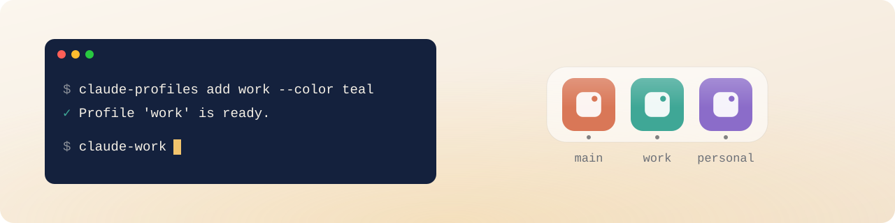

<p align="center">
  
</p>

<h1 align="center">claude-profiles</h1>

<p align="center">
  Several Claude accounts side by side on one Mac.<br>
  Each with its own sign-in, chats, Dock icon, and <code>claude-&lt;name&gt;</code> command.
</p>

<p align="center">
  <a href="#install">Install</a> ·
  <a href="#signing-in-to-desktop">Signing in</a> ·
  <a href="#commands">Commands</a> ·
  <a href="#how-it-works">How it works</a> ·
  <a href="#limitations">Limitations</a>
</p>

<p align="center">
  <picture>
    <source media="(prefers-color-scheme: dark)" srcset="https://raw.githubusercontent.com/ishaba/claude-profiles/assets/banner-dark.svg">
    
  </picture>
</p>

It's a single Bash script with no dependencies, a few hundred lines. Read it
before installing. Claude Code settings can be shared with your main account or
kept separate.

## Install

You need macOS, Claude Desktop in `/Applications`, and Claude Code
(`curl -fsSL https://claude.ai/install.sh | bash`).

```bash
git clone --depth 1 https://github.com/ishaba/claude-profiles ~/.local/share/claude-profiles
~/.local/share/claude-profiles/claude-profiles add work
```

`add` asks how to handle your Claude Code settings. Then:

1. Drag `~/Applications/Claude work.app` to the Dock and open it.
2. Sign in to your second account.
3. In the terminal, run `claude-work` and sign in there too (`/login`).
4. Run `claude-profiles check`:

```text
PROFILE      DESKTOP   CLAUDE CODE ACCOUNT
(main)       -         you@personal.com
work         running   you@company.com

All good.
```

> [!IMPORTANT]
> In Claude Desktop, sign in with **Continue with email**. A browser sign-in
> opens your main Claude instead. See [Signing in to Desktop](#signing-in-to-desktop).

`add` puts the `claude-profiles` and `claude-work` commands in `~/.local/bin`,
next to `claude`. Your main Claude (`/Applications/Claude.app` and `claude`) is
left untouched.

## Signing in to Desktop

Choose **Continue with email** and type in the code from the email. Browser and
Google sign-in, and the link in the email, all return to the app through a
`claude://` link. macOS sends that link to your main Claude, so the profile
never gets signed in.

> [!TIP]
> Prefer the browser? Quit your main Claude first (⌘Q), sign in to the profile,
> then reopen it. The profile stays signed in, and both run side by side from
> then on.

Signing in from the terminal (`claude-work`, then `/login`) works either way.

## Commands

```text
claude-profiles add <name> [--color <color>] [--icon <image>] [--settings shared|copy|empty]
claude-profiles check
claude-profiles remove <name>
claude-<name> [claude arguments]
```

- `add <name>` creates a profile. Run it again to repair the launcher and
  commands; sign-in and chats stay as they are.
- `check` lists your profiles and their accounts, and under each one any
  problem with how to fix it.
- `remove <name>` deletes the profile. Its sign-in and chats stay on disk.
- `claude-<name>` runs Claude Code in that profile.

Options for `add`:

- `--color <color>` tints the icon: orange, red, yellow, green, teal, blue,
  purple, or pink.
- `--icon <image>` uses your own image: png, jpg, or icns.
- `--settings shared` symlinks your Claude Code setup, so a change in one
  shows up in both.
- `--settings copy` copies it once, then the two are independent.
- `--settings empty` starts fresh.

The setup is CLAUDE.md, settings.json, skills, commands, agents, hooks, and
plugins. With `shared` and `copy`, MCP servers are copied too, including any
keys in their settings. Sign-in, chats, history, and memory are never carried
over.

<details>
<summary>Deleting a removed profile's data for good</summary>

<br>

Delete `~/.claude-<name>`, and in `~/Library/Application Support` delete
`Claude-<name>` and `Claude-<name>-3p`. Then open Keychain Access and delete
the profile's "Claude Code-credentials" entry.

</details>

## How it works

A profile is just a name. Every path is derived from it, so there's no registry
to keep in sync. For `work`:

| What | Where |
|---|---|
| Dock launcher | `~/Applications/Claude work.app` |
| App copy, icon, and log | `~/Library/Application Support/claude-profiles/work/` |
| Desktop sign-in, chats, and settings | `~/Library/Application Support/Claude-work` |
| Claude Code sign-in, settings, and memory | `~/.claude-work` |
| Command | `~/.local/bin/claude-work`, a symlink to the script |

Desktop keeps its data in the folder passed with `--user-data-dir`. Claude Code
uses `CLAUDE_CONFIG_DIR` for its files and to keep its Keychain credentials
separate.

Each profile runs its own copy of `Claude.app`, because that's the only way to
get a separate Dock icon. On APFS the copy takes a second and almost no extra
space. Only the launcher creates or changes it, since macOS lets an app modify
apps it created itself. That's why clicking the launcher after a Claude update
is enough to rebuild the copy and restore its icon, with no extra permissions.

To stop the copy from updating itself and restarting on the wrong account, the
script writes Claude's "Block auto-updates" policy to `Claude-work-3p/`. It
applies to this profile only. If that folder already exists, it's left alone,
since it may hold third-party provider settings.

`claude-work` stays quiet when everything is fine, and warns you if the profile
is signed in to the same account as your main Claude.

## Limitations

- **macOS only, and partly unofficial.** Claude Desktop doesn't document
  `--user-data-dir`, an Electron flag. Claude Code documents
  `CLAUDE_CONFIG_DIR`. If Anthropic changes either, the script will need an
  update.
- **Keep the launcher in the Dock**, not the running app's icon. That icon
  starts the copy without the profile's data folder, so it opens your main
  account. If that happens, quit the app and reopen it from the launcher.
- **One subscription covers one seat**, so two profiles need two different
  accounts.

<details>
<summary><b>Migrating from claude-multiprofile</b></summary>

<br>

Your existing profile folders are reused, so you won't need to sign in again.

1. Quit this profile's Claude app.
2. If the data folder name has capital letters, rename it and the `-3p` folder
   next to it:

   ```bash
   cd ~/Library/Application\ Support
   mv Claude-WORK Claude-work.tmp && mv Claude-work.tmp Claude-work
   mv Claude-WORK-3p Claude-work-3p.tmp && mv Claude-work-3p.tmp Claude-work-3p
   ```

3. Remove the `claude-multiprofile` block from `~/.zshrc`, or its alias will
   override the new command.
4. Install claude-profiles as above (`add work`). It replaces the old launcher
   and leaves `~/.claude-work` as is.
5. Once everything works, remove the old Dock icons, run
   `npm uninstall -g claude-multiprofile`, and move
   `~/Library/Application Support/claude-multiprofile` to the Trash.

</details>

## Credits

Ideas from [claude-multiprofile](https://github.com/jmdarre-v/claude-multiprofile)
(MIT): copying the app for a separate icon, blocking auto-updates through `-3p`,
copying MCP servers, and the email sign-in workaround.

## License

[MIT](LICENSE). Not affiliated with Anthropic. Claude is a trademark of
Anthropic.
